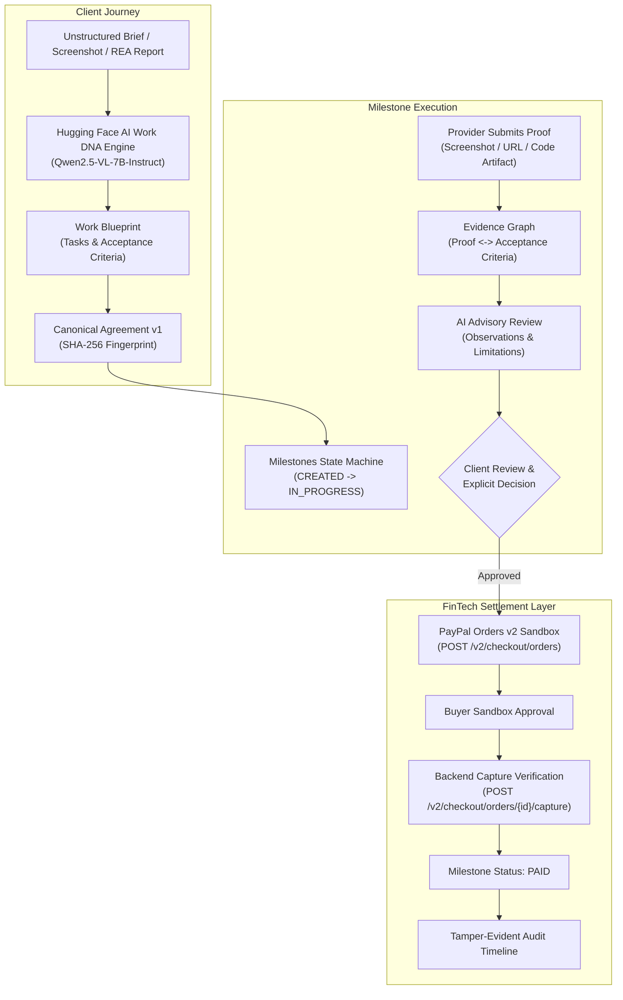

# CLAUSORA ⚡
### AI Work Intelligence, Evidence Verification & PayPal Milestone Payments

> *"Understand the work. Verify the outcome. Release the payment."*

[](https://developer.paypal.com)
[](https://huggingface.co/Qwen/Qwen2.5-VL-7B-Instruct)
[](LICENSE)
[](package.json)
[](https://vercel.com)
[](https://render.com)

---

## 🌟 What is Clausora?

Clausora bridges the trust gap between clients and service providers (developers, freelancers, agencies) by transforming unstructured briefs, documents, screenshots, and runtime traces into a verifiable execution pipeline with human-approved PayPal milestone payouts.

Client requests often begin as vague messages or scattered files. Clausora eliminates misunderstandings by maintaining a continuous, traceable relationship:

$$\text{Raw Brief} \longrightarrow \text{AI Work DNA} \longrightarrow \text{SHA-256 Agreement} \longrightarrow \text{Evidence Graph} \longrightarrow \text{Client Verification} \longrightarrow \text{PayPal Sandbox Capture} \longrightarrow \text{Audit Timeline}$$

---

## 🚀 Key Innovations & Distinctive Features

1. **Work DNA Engine (Multimodal AI)**:
   Powered by Hugging Face's vision-language model `Qwen/Qwen2.5-VL-7B-Instruct`. Ingests plain text briefs, statement of work PDFs, UI screenshots, repository links, or reverse-engineered REA traces to synthesize structured workstreams, verifiable deliverables, observable acceptance criteria, and risk assumptions.

2. **Tamper-Evident Agreement Fingerprints (SHA-256)**:
   Agreed blueprints are canonicalized and fingerprinted with `SHA-256`. Any scope change requires a formal mutual amendment and increments the version (`v1` $\rightarrow$ `v2`), preventing historical revisionism.

3. **Evidence Graph & Limitation Disclosures**:
   Every deliverable criterion is linked to submitted proof artifacts (images, URLs, code commits, REA traces) and AI advisory observations. Unlike misleading black-box "percentage scores", Clausora discloses clear verification limitations (e.g. *"A visual screenshot proves layout presence but does not verify load testing or live runtime payment execution"*).

4. **Scope Drift Radar**:
   A live diff scanner that evaluates incoming client instructions against the approved agreement. It categorizes items into 6 states (`in_scope`, `clarification`, `likely_scope_change`, `deadline_change`, `conflict`, `uncertain`), estimates cost/time impact, and drafts formal amendments instead of silent budget creep.

5. **Deterministic PayPal Orders v2 Sandbox Integration**:
   **Non-negotiable rule**: AI is advisory and never touches money. Only an authenticated client can approve a milestone. Clausora calculates amounts in integer minor currency units (cents), initiates PayPal Sandbox Orders, and confirms server-side capture verification before transitioning a milestone to `PAID`.

6. **REA (Reverse Engineer Anything) Inspector**:
   Integrates seamlessly with [`morluto/rea`](https://github.com/morluto/rea) to import local application runtime inspection reports and map observed behaviors into verifiable project deliverables.

---

## 🏗️ Architecture & Data Flow



---

## 📦 Project Structure

```
Clausora/
├── apps/
│   ├── api/                     # Node.js + Express + TypeScript Backend
│   │   ├── src/
│   │   │   ├── config/          # Zod environment validation
│   │   │   ├── database/        # Mongoose connection + MemoryStore fallback
│   │   │   ├── middleware/      # JWT auth, role guard, error handler
│   │   │   ├── routes/          # Auth, Projects, Blueprint, Agreements, Milestones, Payments, REA
│   │   │   ├── services/
│   │   │   │   ├── ai/          # Hugging Face client (Qwen2.5-VL)
│   │   │   │   ├── paypal/      # PayPal Orders v2 Sandbox direct REST client
│   │   │   │   ├── rea/         # REA inspection ingestion & parsing
│   │   │   │   ├── storage/     # Upload handler & SHA-256 calculation
│   │   │   │   └── notifications/# Transactional notifications
│   │   │   ├── seed.ts          # Demo seeder for evaluators
│   │   │   └── server.ts        # Entry point & health check
│   │   └── tests/               # State machine & agreement hash tests
│   │
│   └── web/                     # React 18 + Vite + Tailwind CSS Frontend
│       ├── src/
│       │   ├── api/             # Axios client with bearer interceptor
│       │   ├── components/      # Evidence Graph, PayPal Modal, Navbar, Sidebar
│       │   ├── context/         # Auth & Fast-Pass persona context
│       │   └── pages/           # Landing, Dashboard, NewProject, ProjectDetail, Auth
│       ├── index.html
│       └── vite.config.ts
│
├── packages/
│   └── shared/                  # Shared Zod schemas, types, constants, canonical hash
│
├── docs/                        # Architecture, Deployment guide, <3 min Demo script
├── render.yaml                  # Render deployment blueprint for API
├── vercel.json                  # Vercel deployment blueprint for Frontend
├── .env.example                 # Environment variables specification
├── LICENSE                      # MIT Open Source License
└── SECURITY.md                  # Security & Hackathon Sandbox Guardrails
```

---

## 🛠️ Quickstart (Run Locally in 60 Seconds)

### 1. Clone & Install Dependencies
```bash
git clone https://github.com/your-username/clausora.git
cd clausora
npm install
```

### 2. Configure Environment (Optional)
Copy `.env.example` to `.env`:
```bash
cp .env.example .env
```
> **Zero-Setup Guarantee**: Clausora is pre-configured with resilient intelligent fallbacks and an automatic in-memory collection store. It runs **immediately out-of-the-box** even before you enter external API tokens!

### 3. Build & Run Concurrently
```bash
# Build all packages
npm run build

# Start both API (port 5000) and Web (port 5173) concurrently
npm run dev
```

- **Frontend App**: [http://localhost:5173](http://localhost:5173)
- **Backend API & Health Check**: [http://localhost:5000/api/health](http://localhost:5000/api/health)

---

## 🧪 Testing

Run backend business logic, milestone state machine, and agreement fingerprint tests:
```bash
npm run test
```
All tests run natively using Node.js test runner with zero extra test-harness overhead.

---

## 👥 Hackathon Judge & Evaluator Credentials

Clausora includes 1-click **Fast-Pass buttons** directly on the Login page and top Navbar so evaluators can switch personas without typing passwords:

| Persona | Role | Email | Password |
|---|---|---|---|
| **Sarah Chen** | Client / Approver | `client@clausora.dev` | `ClausoraClient2026!` |
| **Alex Rivera** | Service Provider / Developer | `provider@clausora.dev` | `ClausoraDev2026!` |
| **Evaluator** | Judge / Reviewer | `judge@paypalhackathon.com` | `JudgeDemo2026!` |

---

## 💳 PayPal Sandbox Integration Setup

1. Sign into [PayPal Developer Dashboard](https://developer.paypal.com).
2. Under **Apps & Credentials > Sandbox**, create a REST App named `Clausora`.
3. Copy your Sandbox **Client ID** and **Secret** to your backend environment:
   ```env
   PAYPAL_MODE=sandbox
   PAYPAL_CLIENT_ID=your_sandbox_client_id
   PAYPAL_CLIENT_SECRET=your_sandbox_secret
   PAYPAL_BASE_URL=https://api-m.sandbox.paypal.com
   ```
4. All test orders are created using PayPal Orders v2 (`POST /v2/checkout/orders`) with intent `CAPTURE` and verified server-side via `POST /v2/checkout/orders/{id}/capture`.

---

## 🤖 Hugging Face AI Model Setup

1. Clausora utilizes **`Qwen/Qwen2.5-VL-7B-Instruct`** for multimodal vision-language understanding.
2. Obtain a free User Access Token from [Hugging Face Settings](https://huggingface.co/settings/tokens).
3. Add it to your backend environment:
   ```env
   HF_TOKEN=hf_your_token_here
   HF_MODEL=Qwen/Qwen2.5-VL-7B-Instruct
   ```

---

## ☁️ Deployment (Vercel + Render + MongoDB Atlas)

See the full step-by-step instructions in [docs/deployment-guide.md](docs/deployment-guide.md).

- **Frontend on Vercel**: `npm run build:web` outputting to `apps/web/dist`. Set `VITE_API_BASE_URL` to your Render API.
- **Backend on Render**: `render.yaml` pre-configured with health check path `/api/health`.

---

## 📜 Security & Sandbox Disclaimer

- **No Escrow or Legal Protection Claimed**: Clausora is a project understanding, verification, and payment orchestration layer. It is not a bank, escrow provider, or legal court.
- **Sandbox Only**: All hackathon transactions occur within the PayPal Sandbox environment. No real funds or card numbers are accepted.
- **Advisory AI Boundaries**: AI cannot trigger payments, approve deliverables, modify budgets, or unilaterally alter contracts. Human client approval is strictly required.

---

## 📄 License

This project is licensed under the [MIT License](LICENSE).
