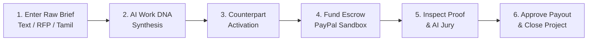

<p align="center">
  
  <span style="font-size: 32px; font-weight: 800; letter-spacing: -0.5px; vertical-align: middle;">CLAUSORA</span>
</p>

<p align="center">
  <b>AI-Powered Deliverable Verification, Scope Drift Governance & PayPal Escrow Platform</b><br>
  <i>"Understand the work. Verify the outcome. Release the payment."</i>
</p>

<p align="center">
  <b>Lead Architect & Author:</b> <b>Hari Tharshini T</b> (<a href="mailto:haritharshinit@gmail.com">haritharshinit@gmail.com</a>)
</p>

<p align="center">
  <a href="https://vercel.com"></a>
  <a href="https://clausora.onrender.com/api/health"></a>
  <a href="https://www.mongodb.com/atlas"></a>
  <a href="https://resend.com"></a>
  <a href="https://developer.paypal.com"></a>
  <a href="https://ai.google.dev/"></a>
  <a href="https://huggingface.co/Qwen/Qwen2.5-VL-7B-Instruct"></a>
</p>

---

## 🧭 Table of Contents

1. [What is Clausora?](#-what-is-clausora)
2. [Production Cloud Architecture & Tech Stack](#-production-cloud-architecture--tech-stack)
3. [Core Platform Functionalities](#-core-platform-functionalities)
4. [App User Guide: How to Use Clausora](#-app-user-guide-how-to-use-clausora)
   - [Client Workflow: Brief to Full Settlement](#1-client-workflow-from-raw-brief-to-project-closure)
   - [Provider Workflow: Acceptance, Proof & Payout](#2-provider-workflow-acceptance-execution--getting-paid)
   - [Admin Workflow: User Auditing & Telemetry](#3-admin-workflow-roster-management--platform-auditing)
5. [Real-World Use Cases](#-real-world-use-cases)
6. [Multi-Agent Review Council ("The AI Jury")](#-multi-agent-review-council-the-ai-jury)
7. [PayPal Sandbox Escrow & Bilateral Governance](#-paypal-sandbox-escrow--bilateral-governance)
8. [Local Developer Quickstart](#-local-developer-quickstart)
9. [Automated Verification Ledger (50 Tests)](#-automated-verification-ledger-50-tests)
10. [Author & License](#-author--license)

---

## 🌟 What is Clausora?

**Clausora** bridges the trust and verification gap between clients and service providers (developers, freelancers, agencies) by transforming unstructured briefs, documents, wireframes, and runtime traces into a verifiable execution pipeline with human-approved PayPal milestone payouts.

Traditional freelance contracts suffer from two major vulnerabilities:
1. **Subjective Scope Drift**: Clients change requirements verbally or through chat; providers perform unpaid work or enter disputes.
2. **Unverified Escrow Releases**: Funds are disbursed based on blind percentages or dates, without cryptographic or verifiable proof that code runs or criteria are satisfied.

Clausora replaces ambiguity with a deterministic lifecycle:

$$\text{Raw Brief} \longrightarrow \text{AI Work DNA} \longrightarrow \text{SHA-256 Agreement} \longrightarrow \text{Evidence Graph} \longrightarrow \text{3-Agent AI Jury} \longrightarrow \text{PayPal Capture} \longrightarrow \text{Full Closure}$$

---

## ☁️ Production Cloud Architecture & Tech Stack

Clausora is deployed across production cloud infrastructure with high availability, firewall resilience, and role isolation:

| Infrastructure Layer | Cloud Platform | Technology Stack | Production URL / Details |
| :--- | :--- | :--- | :--- |
| **Frontend Web App** | **Vercel** | React 19, Vite, Tailwind CSS, Lucide Icons | Production Edge SPA with reverse proxy routing `/api/:path*` directly to backend |
| **Backend REST API** | **Render** | Node.js 20 LTS, Express, TypeScript, Zod | `https://clausora.onrender.com`<br>Reverse proxy trust, dynamic rate limiting, secure cookies |
| **Cloud Database** | **MongoDB Atlas** | MongoDB 7.0 (M0 Replica Set Cloud Cluster) | Multi-tenant user, project, milestone collections with automatic in-memory cache sync |
| **Transactional Email** | **Resend & SMTP** | Resend HTTPS REST API (Port 443) + Nodemailer | Instant 6-digit OTP delivery immune to cloud firewall port 587/465 blocks; 3.5s race timeout |
| **Multimodal AI** | **Google & Hugging Face** | Gemini 1.5 Pro (Flagship Higher Model) + Qwen2.5-VL-7B | 2M token context window, deep multimodal vision reasoning, Tamil & multilingual token parsing, 9-dim quality radar, 3-Agent AI Review Council |
| **Escrow & Payments** | **PayPal Developer** | PayPal Orders v2 REST API (Sandbox) | Instant server-side capture, split milestone payouts, settled ledger tracking |
| **Universal Monorepo** | **npm Workspaces** | `@clausora/shared`, `@clausora/api`, `@clausora/web` | Unified TypeScript type contracts, shared Zod validators, SHA-256 canonical hashing |

---

## ⚡ Core Platform Functionalities

### 1. Multimodal AI Work DNA Generator (Gemini 1.5 Pro & Qwen2.5-VL)
- Ingests freeform client briefs, technical RFPs, UI wireframes, architecture diagrams, or REA traces.
- Powered by Google's flagship higher-tier reasoning model, **Google Gemini 1.5 Pro** (`gemini-1.5-pro` with 2,000,000 token context window), coupled with Hugging Face's premier vision-language model, **Qwen/Qwen2.5-VL-7B-Instruct**.
- Generates structured workstreams, modular deliverables, and verifiable acceptance criteria.
- **Multilingual & Tamil Token Support**: Natively extracts deliverables from Tamil script (`[\u0B80-\u0BFF]`), Hindi, Spanish, French, German, Arabic, and Japanese.
- **Financial & Timeline Conservatism**: Never hallucinates unconfirmed budgets or speculative deadlines.

### 2. Bilateral Counterpart Governance (Anti-Self-Approval Theorem)
- Eliminates unilateral contract manipulation.
- When a Client creates a project proposal, it enters an immutable `awaiting_approval` state.
- **Mathematical Rule**: The creator cannot approve or activate their own proposal (returns HTTP 403 Forbidden).
- The designated counterpart (e.g. assigned Provider) must review and click **Approve & Activate Project**.

### 3. Proof-Before-Payout Enforcement & Evidence Hub
- Milestone escrow funds remain physically locked.
- The **Approve & Release Payment** button is disabled until the Provider submits verifiable proof artifacts.
- Supports 4 verification modalities:
  - 🌐 **Live URL / Staging**: Interactive endpoints, deployed websites.
  - 💻 **Git Commit / SHA**: Repository pull requests, commit hashes.
  - 📸 **Visual Screenshots**: UI layout, responsive 375px mobile proofs.
  - 📄 **Technical Documentation**: Architecture runbooks, schema definitions.

### 4. Multi-Agent AI Review Council ("The AI Jury")
- Autonomous 3-agent review council auditing deliverables in parallel:
  - 🏛️ **Architecture Auditor**: Validates contract adherence, API design, and modularity.
  - 🛡️ **Security Verifier**: Checks authentication, TLS transport, and injection vectors.
  - 🧪 **QA Test Specialist**: Audits automated test coverage, proof validity, and bug surface.
- Rejects unproven claims with immediate warnings and computes a consensus verdict: `APPROVED`, `REVISE`, or `REJECT`.

### 5. Interactive Scope Drift Radar & Budget Impact Estimator
- Evaluates incoming change requests against the frozen SHA-256 agreement baseline.
- Categorizes each request into 6 deterministic states:
  - `in_scope`: Covered by existing milestones (no charge).
  - `clarification`: Minor specification detail (no charge).
  - `likely_scope_change`: Net-new scope requiring additional budget and days.
  - `deadline_change`: Timeline modification affecting roadmap delivery.
  - `conflict`: Direct contradiction with signed contract terms.
  - `uncertain`: Ambiguous request requiring human clarification.
- Generates formal mutual amendment proposals instead of silent budget creep.

### 6. Deterministic PayPal Sandbox Escrow & Split Settlement
- Direct integration with PayPal Orders v2 REST API (`https://api-m.sandbox.paypal.com`).
- Creates escrow orders with capture intent.
- Executes instant server-side capture upon client sign-off.
- Supports flexible split milestone installments (e.g. 50% deposit, 50% final deliverable).

### 7. Clausora AI Advisory Drawer (Floating Copilot)
- Context-aware intelligence drawer accessible from any project screen.
- Answers questions citing exact project parameters, budgets, deadlines, and technical architecture.
- Generates multi-perspective summaries and actionable governance guidance.

### 8. Full Payment Project Closure Protocol
- Enforces financial completion before contract archiving:
  $$\text{CanClose} \iff (\text{SettledMinor} \ge \text{TotalBudgetMinor} > 0) \lor (\forall m \in \text{Milestones}, m.\text{status} = \text{'PAID'})$$
- Once 100% funded and paid, the **Close Project** button is enabled in the cockpit.
- Transitions project to `completed`, removes it from active navigation, and preserves permanent audit history.

---

## 📖 App User Guide: How to Use Clausora

Clausora includes 1-click **Fast-Pass buttons** directly on the Login page and Navigation bar to switch between the three roles instantly:

| Persona | Role | Email | Password | Primary Scope & Authority |
| :--- | :--- | :--- | :--- | :--- |
| **Sarah Chen** | `client` | `client@clausora.dev` | `Password123!` | Proposes projects, reviews Work DNA, funds PayPal escrow, inspects proofs, approves payouts. |
| **Alex Rivera** | `provider` | `provider@clausora.dev` | `Password123!` | Reviews proposals, activates contracts, executes tasks, submits proof, receives disbursements. |
| **Marcus Vance** | `admin` | `admin@clausora.dev` | `Password123!` | System-wide admin portal, user roster management, platform escrow ledger, health diagnostics. |

---

### 1. Client Workflow: From Raw Brief to Project Closure



1. **Create Project Proposal**:
   - Log in as **Sarah Chen** (Client).
   - Click **New Project** in the sidebar.
   - Enter your project brief (e.g., *"Build an E-commerce Mobile App with Tamil & English localization"*).
   - Click **Generate Work DNA**. Dual AI engines synthesize the tasks, milestones, acceptance criteria, and quality scores.
   - Enter the budget (e.g. `$2,500`) and select **Alex Rivera** as the assigned provider.
   - Click **Create Project Proposal**.

2. **Wait for Counterpart Activation**:
   - The project status displays `awaiting_approval`.
   - As the creator, you cannot self-approve. Your assigned provider (Alex) receives a notification to review and activate the contract.

3. **Fund Milestone Escrow**:
   - Once activated, navigate to the **Milestones** tab in the project cockpit.
   - On Milestone 1, click **Fund Escrow (PayPal)**.
   - The PayPal Sandbox modal launches. Log in with a sandbox personal account or click **Demo Sandbox Capture** to lock funds into escrow.

4. **Inspect Proof & Review AI Jury Verdict**:
   - When the provider submits proof, open the **Evidence Hub**.
   - Review submitted live URLs, git repository links, or screenshots.
   - Click **Run Council Review** to view the 3-agent AI consensus scores (Architecture, Security, QA).

5. **Approve Payout & Close Project**:
   - If satisfied, click **Approve & Release Payment**.
   - The PayPal backend executes instant capture, marking Milestone 1 as `PAID`.
   - Once all milestones are paid, the **Close Project** button turns green in the top action bar. Click it to officially complete and archive the project.

---

### 2. Provider Workflow: Acceptance, Execution & Getting Paid

1. **Review & Activate Proposal**:
   - Log in as **Alex Rivera** (Provider).
   - Projects awaiting your approval appear in your dashboard with an orange badge (`Awaiting Your Approval`).
   - Open the project, review the deliverable milestones, and click **Approve & Activate Project**.
   - Status updates to `active` and generates a tamper-evident SHA-256 agreement baseline.

2. **Execute Deliverable Tasks**:
   - Under the **Tasks & Deliverables** tab, track your progress.
   - Move tasks across states (`Todo` $\rightarrow$ `In Progress` $\rightarrow$ `Submitted` $\rightarrow$ `Done`).
   - Milestone progress bars calculate completion mathematically in real-time.

3. **Submit Verifiable Work Proof**:
   - Under the milestone you are completing, click **Submit Proof**.
   - Select the artifact type: `live_url`, `code_review` (Git SHA), `visual_inspection` (screenshot), or `document_audit`.
   - Enter the link and deliverable description.

4. **Trigger AI Review Council**:
   - Click **Run Council Review**. The 3-agent jury inspects the evidence and gives an advisory consensus rating.

5. **Receive Settlement Disbursement**:
   - The client receives the notification, reviews the proof, and clicks approve.
   - PayPal disburses the milestone payout directly to your provider balance.

---

### 3. Admin Workflow: Roster Management & Platform Auditing

1. **User Roster Management**:
   - Log in as **Marcus Vance** (Admin).
   - Open the **Admin Portal** from the navigation bar.
   - View all registered platform users. You can edit user names, emails, and roles (`client`, `provider`, `admin`) or delete test accounts.

2. **Global Escrow Settlement Ledger**:
   - View total platform escrow volume, captured payouts, active project balances, and payment transaction hashes.

3. **System Telemetry & Health Diagnostics**:
   - Verify live connection to **MongoDB Atlas**, Render server uptime, and email delivery queue status.

---

## 💼 Real-World Use Cases

```
┌────────────────────────────────────────────────────────────────────────────┐
│ 💼 Use Case 1: Freelance Web Application Contract                          │
│                                                                            │
│ Problem: A client hires a remote developer for $4,000 across 3 milestones. │
│ The client worries about paying upfront; the developer worries about not   │
│ getting paid after writing code.                                           │
│                                                                            │
│ Clausora Solution:                                                         │
│ 1. AI synthesizes 3 milestones (Auth/DB, Core UI, Production Deploy).     │
│ 2. Client funds Milestone 1 into PayPal escrow.                            │
│ 3. Developer submits staging link + GitHub commit SHA.                     │
│ 4. AI Jury verifies security and tests; client inspects proof.             │
│ 5. Funds released instantly. Both parties are 100% protected.              │
└────────────────────────────────────────────────────────────────────────────┘
```

```
┌────────────────────────────────────────────────────────────────────────────┐
│ 🎨 Use Case 2: Digital Marketing & Creative Agency Deliverables            │
│                                                                            │
│ Problem: Client constantly adds requests ("Can you also make 5 more banner │
│ variations and 2 landing pages?") without increasing the agreed budget.     │
│                                                                            │
│ Clausora Solution:                                                         │
│ The Scope Drift Radar evaluates the client's chat messages against the    │
│ frozen SHA-256 agreement. It flags the requests as `likely_scope_change`,  │
│ computes +$600 and +3 days estimated impact, and generates a formal        │
│ change order for mutual signature.                                         │
└────────────────────────────────────────────────────────────────────────────┘
```

```
┌────────────────────────────────────────────────────────────────────────────┐
│ 🌐 Use Case 3: Offshore Multilingual Outsourcing (Tamil / English)         │
│                                                                            │
│ Problem: A regional business owner submits a specification in Tamil script │
│ to an international agency that communicates exclusively in English.       │
│                                                                            │
│ Clausora Solution:                                                         │
│ The multimodal Work DNA engine detects Unicode Tamil characters            │
│ ([\u0B80-\u0BFF]), parses the business intent, and synthesizes standard    │
│ English technical deliverables while preserving Tamil domain terminology.  │
└────────────────────────────────────────────────────────────────────────────┘
```

---

## ⚖️ Multi-Agent Review Council ("The AI Jury")

Clausora rejects fallible single-prompt AI evaluation in favor of an **adversarial 3-agent deliberative jury**:

| Juror | Persona Role | Audit Focus | Evaluation Methodology |
| :--- | :--- | :--- | :--- |
| **Juror 1** | 🏛️ **Architecture Auditor** | Contract & System Design | Verifies schema consistency, RESTful API conventions, database integrity, and separation of concerns. |
| **Juror 2** | 🛡️ **Security Verifier** | Defensive Protection | Audits JWT lifetimes, CORS, input sanitization, rate limiting, and defensive credentials storage. |
| **Juror 3** | 🧪 **QA Test Specialist** | Deliverable & Acceptance Verification | Checks test suite coverage, verifies submitted staging URLs / git commits, and audits visual UI proofs. |

> **Consensus Threshold**:
> - Score $\ge 80$: **APPROVED** (Recommended for immediate client payment release).
> - Score $50 - 79$: **REVISE** (Minor issues flagged; provider asked for revision).
> - Score $< 50$ or Zero Evidence: **REJECT / WARNING** (Payout button blocked; evidence required).

---

## 🔒 PayPal Sandbox Escrow & Bilateral Governance

### Security Theorems Implemented:

1. **Anti-Self-Approval Theorem**:
   $$\forall p \in \text{Projects}, \quad \text{CanAccept}(u, p) \implies u.\text{id} \ne p.\text{createdBy}$$
   Prevents any user from unilaterally activating a contract without counterpart consent.

2. **Zero-Unverified-Payout Theorem**:
   $$\forall m \in \text{Milestones}, \quad \text{CanReleasePayout}(m) \implies |\text{Evidence}(m)| > 0$$
   Guarantees that escrow funds cannot be captured until at least one verifiable proof artifact is submitted.

3. **Tamper-Evident SHA-256 Canonical Agreement Freezing**:
   $$\text{AgreementHash} = \text{SHA-256}\left(\text{AlphabeticallySortedJSON}(\text{Terms})\right)$$
   Any change to budget, milestones, or deadlines alters the hash digest, alerting all parties immediately.

---

## 💻 Local Developer Quickstart

### 1. Prerequisites
- **Node.js**: v18.0.0 or higher (v20 LTS recommended)
- **npm**: v9.0.0 or higher
- **Git**

### 2. Clone & Install Dependencies
```bash
git clone https://github.com/your-username/clausora.git
cd clausora
npm install
```

### 3. Configure Environment Variables
Copy `.env.example` to `.env`:
```bash
cp .env.example .env
```
Key configuration items:
```env
# Server
PORT=5000
NODE_ENV=development
JWT_SECRET=clausora_secure_production_secret_2026
JWT_EXPIRATION=86400

# Cloud Database (MongoDB Atlas)
MONGODB_URI=mongodb+srv://<username>:<password>@cluster0.mongodb.net/clausora?retryWrites=true&w=majority

# Transactional Email (Resend HTTPS API)
RESEND_API_KEY=re_your_resend_api_key_here
EMAIL_FROM="Clausora <notifications@clausora.dev>"

# Escrow & Payments (PayPal Sandbox)
PAYPAL_MODE=sandbox
PAYPAL_CLIENT_ID=your_paypal_sandbox_client_id
PAYPAL_CLIENT_SECRET=your_paypal_sandbox_secret
PAYPAL_BASE_URL=https://api-m.sandbox.paypal.com

# AI Models (Google Gemini Higher Model & Hugging Face)
GEMINI_API_KEY=your_gemini_api_key_here
GEMINI_MODEL=gemini-1.5-pro
HF_TOKEN=hf_your_huggingface_token_here
HF_MODEL=Qwen/Qwen2.5-VL-7B-Instruct
```
*(Note: Clausora includes built-in in-memory stores and resilient fallback generators; it starts cleanly out-of-the-box even before external credentials are populated!)*

### 4. Build and Run Concurrently
```bash
# Build all monorepo packages (@clausora/shared, @clausora/api, @clausora/web)
npm run build

# Start both API (port 5000) and Web (port 5173) concurrently
npm run dev
```

- **Web Frontend**: [http://localhost:5173](http://localhost:5173)
- **API Health Check**: [http://localhost:5000/api/health](http://localhost:5000/api/health)

---

## 🧪 Automated Verification Ledger (50 Tests)

Run the complete native test suite across business logic, state machines, and security:
```bash
npm run test -w @clausora/api
```

```
▶ Multi-Agent Review Council & Clausora AI Intelligence (12 Tests)     PASS ✔
▶ Security, Auth & Role Isolation Tests (4 Tests)                     PASS ✔
▶ Password Recovery, OTP & Resend/SMTP Email System (5 Tests)         PASS ✔
▶ AI Work DNA Blueprint Synthesis & Workflow Tests (1 Test)           PASS ✔
▶ Clausora API Server Health & Routes (2 Tests)                       PASS ✔
▶ Project Permissions & Bilateral Acceptance (12 Tests)               PASS ✔
▶ Milestone State Machine Safety (3 Tests)                            PASS ✔
▶ Canonical Agreement Fingerprint SHA-256 (2 Tests)                   PASS ✔
▶ Admin User Edit & Delete Capabilities (2 Tests)                     PASS ✔
▶ Advanced Work DNA Intelligence Engine (Tamil & 9-Dim) (7 Tests)     PASS ✔
─────────────────────────────────────────────────────────────────────────────
TOTAL: 50 Passing Tests | 10 Suites | 0 Failures | 100% Green
```

---

## 👩‍💻 Author & Lead Architect

**Hari Tharshini T**  
- **Role:** Creator & Lead System Architect  
- **Email:** [haritharshinit@gmail.com](mailto:haritharshinit@gmail.com)  
- **Project:** Clausora — AI Work DNA, Multi-Agent Review Council & Deliverable-Verified PayPal Escrow

---

## 📄 License

This project is licensed under the [MIT License](LICENSE).
