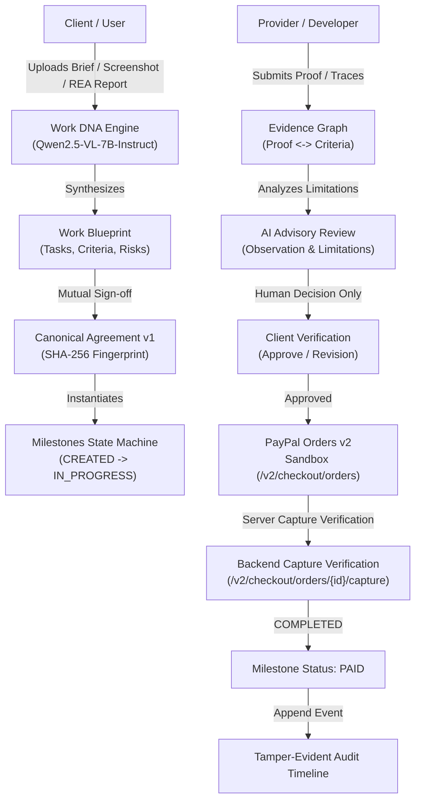
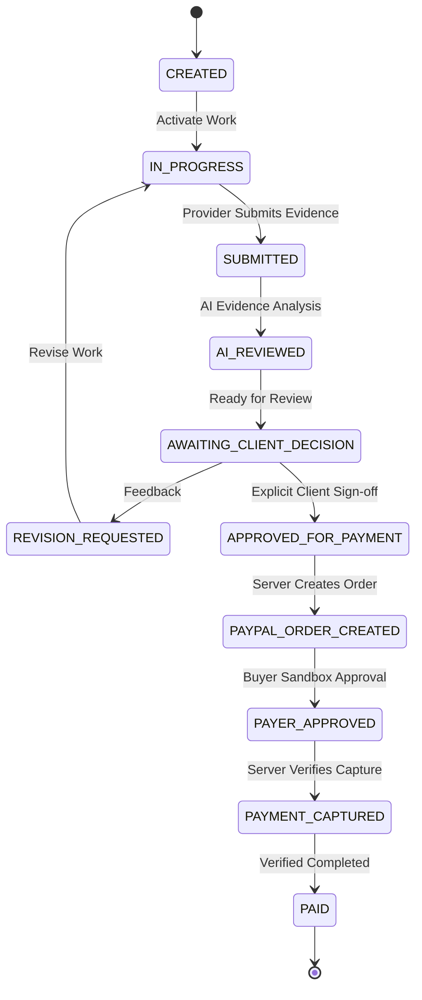

# Clausora Architecture & Technical Specifications

## 1. System Overview

Clausora is an AI-powered work intelligence and milestone payment orchestration layer. It transforms ambiguous briefs into verifiable deliverables, maintains an immutable agreement record via canonical SHA-256 fingerprinting, flags scope changes, and triggers PayPal sandbox payouts strictly upon human client verification.

## 2. Milestone State Machine Lifecycle

## 3. Cryptographic Agreement Fingerprinting

To guarantee that agreement terms cannot be tampered with retroactively:
1. The agreed blueprint object (`projectTitle`, `workstreams`, `milestones`, `totalAmountMinor`, `currency`) is canonicalized using deterministic key sorting.
2. The canonical JSON string is hashed using `SHA-256`.
3. Both parties store the `snapshotHashSeen` with their digital timestamp upon signing.
4. Any subsequent change request detected by the Scope Drift Radar creates a new version (`v2`) with its own fingerprint, preserving the immutable history.

## 4. REA (Reverse Engineer Anything) Integration

In accordance with Section 15 of the specification:
- Developers and inspectors can run REA (`npx rea-agents setup` / `morluto/rea`) locally on authorized applications.
- REA extracts runtime traces, network captures, and discovered API surfaces into a standardized JSON report.
- Clausora's Work DNA Engine ingests this report via `POST /api/rea/import-report` and maps observed behaviors directly into verifiable deliverable milestones.
